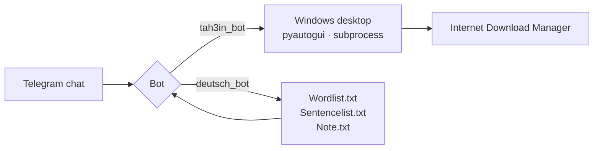

# TelegramBots


Two small Telegram bots in Python: one controls a Windows desktop from the chat, the other drills German vocabulary and sentences. Both run locally and use `pyTelegramBotAPI` (`telebot`).

## How they work



## Bots

### `tah3in_bot` — desktop remote control

- Accepts links and starts downloads through Internet Download Manager (`Open_IDM.py`).
- Drives the desktop via `pyautogui` and `subprocess` (open files and folders, take screenshots).
- Tracks per-chat state (`user_states`) so multi-step commands work.
- Owner-only commands (`/start`, `/Shutdown`) are protected by a user-ID allow-list.
- Entry point: `tah3in_bot.py`

### `deutsch_bot` — vocabulary and sentence trainer

- Reads word and sentence lists from `Wordlist.txt` and `Sentencelist.txt`.
- Quizzes words and sentences, and writes new entries back to the list (`replace_line_in_file`).
- Auto-display modes push one item every few seconds for passive repetition.
- Entry point: `deutsch_bot.py`

## Setup

1. Create a bot token with [@BotFather](https://t.me/BotFather) and export it — the token never belongs in the source:

   ```bash
   # PowerShell
   $env:BOT_TOKEN="123456:ABC..."
   ```

2. Install dependencies:

   ```bash
   pip install pyTelegramBotAPI pyautogui
   ```

3. Start a bot from its own folder:

   ```bash
   cd tah3in_bot && python tah3in_bot.py
   cd deutsch_bot && python deutsch_bot.py
   ```

## Commands (`deutsch_bot`)

| Command | Action |
| --- | --- |
| `/AddW`, `/AddS`, `/AddN` | Add a word, sentence or note |
| `/DisplayW`, `/DisplayS`, `/DisplayN` | Show the next random entry |
| `/DisplayAutoW [n]`, `/DisplayAutoS [n]` | Auto-display `n` entries (default 20) |
| `/Edit` | Fix an existing entry by its original text |
| `/help`, `/Exit` | Help / leave the current mode |

## Requirements

- Windows (desktop control and IDM integration are Windows-specific)
- Python 3.10+
- Internet Download Manager for `Open_IDM.py`
